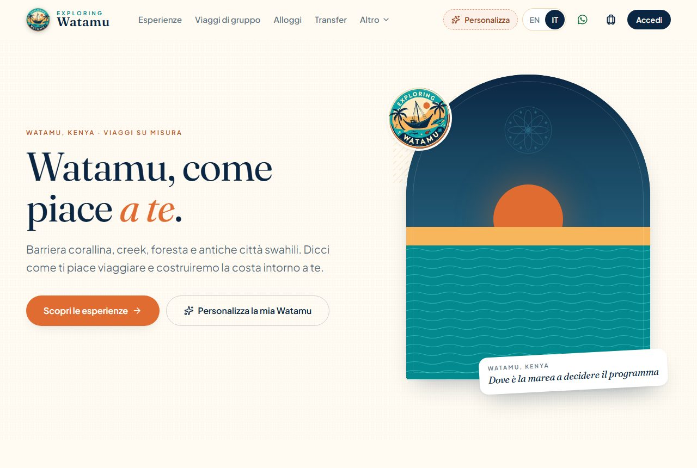
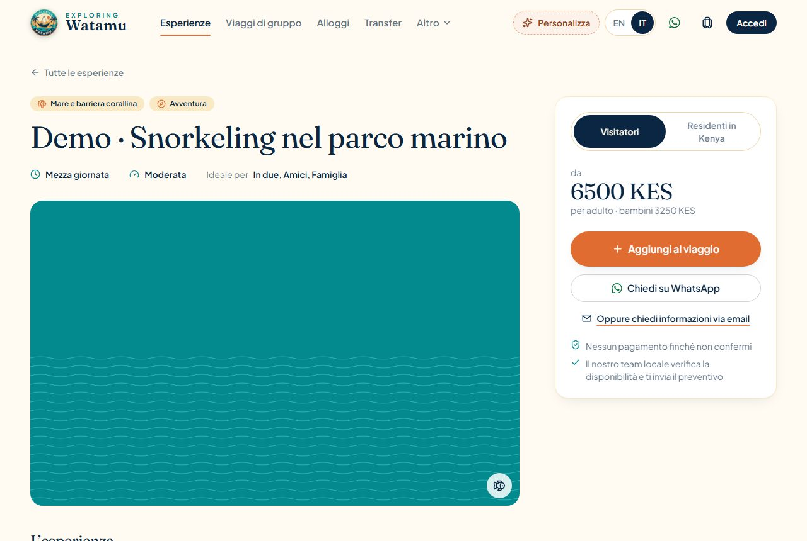
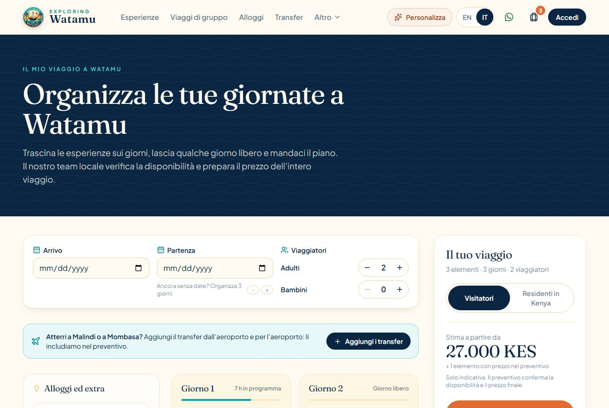
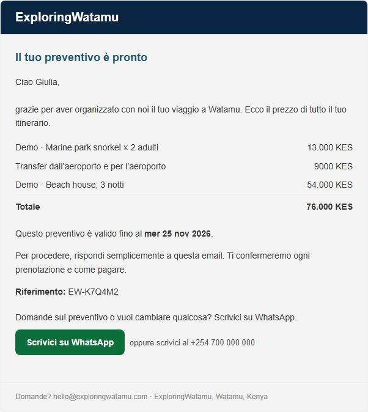
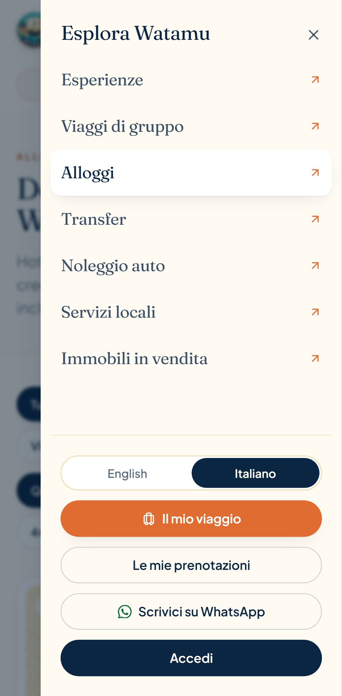
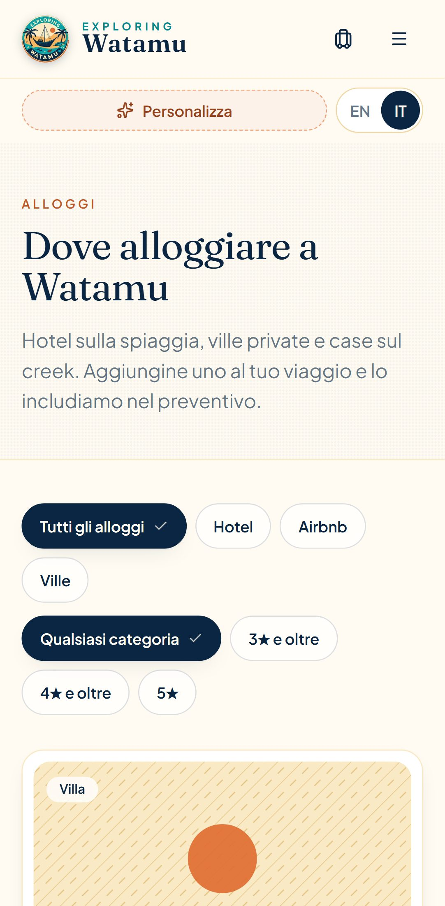
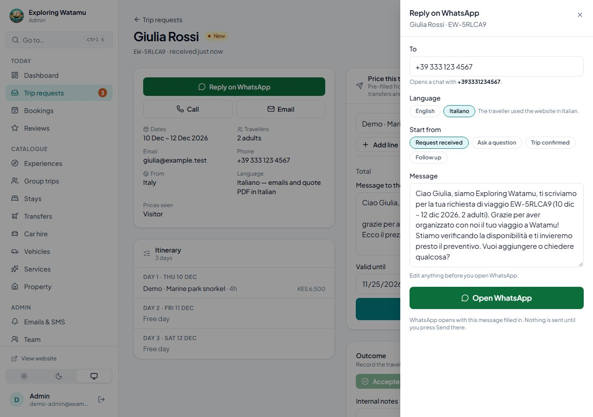
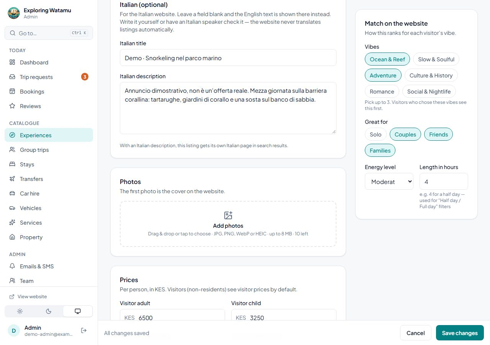

# English and Italian

The public website works in English and Italian. English stays the default and keeps every
existing address; Italian lives under `/it` with the same paths after it. Travellers who use
the Italian site get their emails, texts and PDFs in Italian. The team keeps working in
English and can add optional Italian text to listings in the admin portal.

| | |
|---|---|
|  |  |
| Homepage in Italian, with the **EN / IT** switcher in the header | An experience the team has written Italian text for |
|  |  |
| The trip planner | The quote email an Italian traveller receives |

## For visitors

- **Switching.** **EN | IT** sits in the header (on phones, in the row under the logo), in
  the menu and in the footer, and on the first-visit "What's your Watamu?" screen so an
  Italian visitor can switch before answering. Each option is a real link to the same page in
  the other language: it works with the keyboard, can be opened in a new tab, and the current
  language is filled in and announced (`aria-current`).
- **Remembering.** The site remembers the last language used on the device. Someone who
  chose Italian and later opens an English link (a bookmark, an email) is taken to the same
  page in Italian. Moving around the site never drops the language; Back and Forward follow
  the address. Storage that is blocked or holds anything unexpected is ignored: the address
  decides.
- **Listing text.** Our own words are always Italian. A listing's own text (its name and
  description) is the team's Italian when they wrote one, and the English otherwise. English
  text on an Italian page is marked `lang="en"` so screen readers read it as English.
  Listing text is never machine-translated.
- **Dates, numbers and prices** follow the language: *dom 10 gen 2027*, *18.000 KES*,
  *4,8 ★*. Prices are display only; nothing that is stored, quoted or charged changes.

## How it works

### Addresses

| English | Italian |
|---|---|
| `/` | `/it` |
| `/experiences`, `/experiences/:id` | `/it/experiences`, `/it/experiences/:id` |
| `/group-trips/:slug`, `/trip`, `/my-trips`, … | `/it/group-trips/:slug`, `/it/trip`, `/it/my-trips`, … |

The Italian prefix is the router's `basename` (`client-vite/src/i18n/LocaleRouter.jsx`), so
every existing link and redirect in the code already points at the right language. The
language is decided before the first render (`bootLocale()` in `main.jsx`), from the address
and, for an English address, the remembered choice.

### Messages

- `client-vite/src/i18n/` — the language core: language and path helpers (`locales.js`),
  `useI18n(messages)` for components, `translator(messages)` for plain library code,
  plurals (`Intl.PluralRules`), `{placeholders}`, simple `<b>…</b>` markup (`rich`), and
  formatting (`formatKES`, `formatNumber`, `weekdayName`, `localeTag`).
- `client-vite/src/locales/<area>.js` — the messages, one file per area, English and Italian
  side by side with the same keys: `common`, `layout`, `home`, `personalise`, `vibes`,
  `catalog`, `cards`, `experiences`, `listings`, `groupTrips`, `trip`, `planner`, `account`,
  `ratings`, `reviews`, `whatsapp`. Small shared files (`cards`, `ratings`, `trip`) load with
  the homepage; page files load with their page.
- A message missing in Italian shows the English one; a message missing everywhere shows its
  key (and a warning in development) — never a blank. `src/locales/locales.test.js` fails if
  the two languages ever differ in keys, placeholders or markup.
- No i18n library was added: the core is ~2 KB gzip and fits the app's SEO setup.

### Search engines and link previews

Built HTML (`client-vite/seo/plugin.js`, text in `seo/routes.js`) — what crawlers that don't
run JavaScript see:

- One HTML file per static page **and language**: `dist/experiences.html` (English, as before)
  and `dist/it/experiences.html`, `dist/it.html` for the Italian homepage. Each has its own
  `<html lang>`, title, description, canonical, `og:locale` and the hreflang pair
  (`en`, `it`, `x-default` → English). Sign-in pages stay `noindex`, without the pair.
- `sitemap.xml` lists both languages of every static page with their `xhtml:link` alternates.
- `robots.txt` keeps private pages out in both languages (`/my-trips`, `/it/my-trips`,
  `/review/`, `/it/review/`, …).
- `vercel.json` serves `/it/…` addresses without their own file from `it.html`
  (Italian shell), as `/…` falls back to `index.html`.

In the browser (`components/seo/Seo.jsx`) every page renders the same tags in its language.

**Listing pages and hreflang.** An experience or group trip has a real Italian page only when
the team has written its Italian description (`descriptionIt` or `shortDescriptionIt`). Then
its Italian page has its own canonical and the hreflang pair, and the sitemap lists it. Without
one, the Italian address still works for visitors (Italian interface, English text), but it
names the English page as canonical and claims no translation — so search engines never get
hreflang pointing two languages at the same English text. The rule lives in
`src/i18n/listingContent.js` and is mirrored in the bot-preview middleware.

**Bot previews** (`client-vite/middleware.js`): WhatsApp, Facebook, Google and other bots now
also get previews for `/it/experiences/:id` and `/it/group-trips/:slug`: `lang="it"`, the
team's Italian title and description when there are some, `og:locale` and the same canonical
/ hreflang rule. People are never affected.

### Emails, texts and PDFs

The website sends its language with trip requests, group-trip bookings, sign-ups,
confirmation-link and password-reset requests. It is stored on the trip request and the booking (`locale`: `en` or `it`; older
records are English) and used for:

| Sent to the traveller | Italian |
|---|---|
| Trip request received (email + SMS) | Yes |
| Quote email + quote PDF + SMS | Yes |
| Trip confirmed / declined / cancelled | Yes |
| Group trip: request received + quotation PDF + SMS | Yes (the trip's Italian title when it has one) |
| Group trip: confirmed + receipt PDF + SMS, cancelled + SMS | Yes |
| Password reset (email and its link, `/it/reset-password`) | Yes |
| Email confirmation at sign-up (email and its link, `/it/verify-email`) | Yes |
| Post-trip review invitation (email and its link, `/it/review/…`) | Yes |
| WhatsApp messages prefilled from emails and PDFs | Yes |

Team notifications stay English, with a "Language: Italian" line so the team knows. Messages
live in `backend/src/i18n/en.js` and `it.js` (same keys, checked by `tests/i18n.test.js`);
templates call `i18n.forLocale(locale)`. English output is exactly what it was. Amounts and
quote values are never changed — only how they are written.

### WhatsApp

Every prefilled message a visitor sends us (header, listings, planner, references) is in the
page's language, and links in it point at the page in that language. In the admin portal,
**Reply on WhatsApp** starts in the traveller's language with an **English / Italiano**
choice, and the quote message is pre-filled in Italian for Italian requests.

### Admin portal

The admin portal stays English (it's the team's tool). What changed:

- **Italian (optional)** on every listing form: the Italian title and/or description(s) for
  experiences, group trips, stays, transfers, car hire, services and property. Nothing is
  required; a blank field shows the English text; clearing a field clears it on the website.
  Experiences and group trips say whether the listing now has its own Italian page.
- **Language** on trip requests ("Italiano — emails and quote PDF in Italian") and an **IT**
  tag on Italian group-trip bookings.

## Translation coverage

| Area | Status |
|---|---|
| Header, menus, footer, skip link, logo | Italian |
| Homepage: hero, picks, ways in, how it works | Italian |
| Personalisation: onboarding questions and answers, header pill, headline | Italian |
| Experiences: filters, sort, cards, match reasons, empty and error states | Italian |
| Experience page: details, prices, panels, structured data | Italian (+ listing text, see below) |
| Stays, transfers, car hire, services, property and viewing booking | Italian |
| Group trips: list, page, countdown, join request, who's going, e-card, Safari Points | Italian |
| Trip planner, board (incl. screen-reader drag announcements), drawer, toast | Italian |
| Quote request form, validation and confirmation page | Italian |
| My bookings: quotes, statuses, group bookings, reviews, "confirm your email" notice | Italian |
| Reviews: ratings, reading, writing, photos, refusals | Italian |
| Sign in, register (incl. Google's button), forgot and reset password, email confirmation | Italian |
| Loading, empty, error, 404 and crash pages | Italian |
| API errors shown to visitors | Known ones in Italian; anything else shows a general Italian message |
| Page titles, descriptions, social previews, sitemap, `lang` | Italian |
| WhatsApp prefilled messages | Italian |
| Traveller emails, SMS and PDFs | Italian (see the table above) |
| Admin portal | English, with Italian content fields and Italian replies |

**Intentionally English**

- **Listing text without an Italian version**, and listing fields that have no Italian field:
  highlights, what to bring, best time, itinerary days, included / not included, meeting point,
  accommodation details, facilities, room types, FAQs, house rules, vehicle names, transfer
  routes. They are the team's own content; translating them automatically could be wrong, and
  inventing Italian partner content isn't allowed. They show marked `lang="en"`.
- **Reviews** — in the language the traveller wrote them.
- **The team's quote lines and message** — written by the team (pre-filled in Italian for
  Italian requests).
- **What is stored and sent to the team**: trip item titles, day labels, travel personalities,
  data values. They are English data for the team; the website and the traveller's emails say
  them in Italian where they are our own words ("Alloggio · …", airport transfers, "prezzo di
  listino") and keep listing names as they are.
- **Brand and place names** — Exploring Watamu, Mida Creek, Gede, Malindi…
- **Admin portal and team emails** — the team works in English.
- **`/style-guide`** — an internal design page, not linked and not indexed.

## Decisions

- **URL strategy: `/it` prefix, same paths.** Distinct addresses per language (needed for
  hreflang and sharing), every English URL unchanged, one rewrite on Vercel. Translated path
  segments (`/it/esperienze`) were not worth the extra routing and redirects.
- **Data stays English; the page translates.** Trip items saved on a device before the switch,
  and requests the team reads, stay readable in either language.
- **Both languages in each message file.** Easier to keep in step (and checked by a test).
  The cost is in the first load: the website's up-front JavaScript grew from 176.4 KB to
  188.8 KB gzip — the Italian text for the shell and homepage (~6 KB), every page's search text
  (~2 KB) and the language code (~2 KB). Page text loads with its page. The admin is unchanged
  (157.8 KB). If it matters later, the Italian half can be loaded on demand for Italian
  visitors only.
- **EUR prices: left out.** The brief made it optional. Showing euros needs an exchange rate
  someone keeps up to date and a clear "indicative" note everywhere prices appear, while quotes
  are priced and paid in KES — a stale rate would mislead. If wanted later: display only, a
  configurable rate (an environment variable with its date), labelled "≈ €… (indicative)",
  never stored or quoted.

## For the team

- **Writing Italian listing text.** Admin → the listing → **Italian (optional)**. Start with
  experiences and group trips: an Italian description gives them their own Italian page in
  search results. Write it yourself or have an Italian speaker check it.
- **Changing a website text.** Edit both languages in `client-vite/src/locales/<area>.js`;
  for emails, `backend/src/i18n/en.js` and `it.js`. Run the tests: they catch a missing
  language, a lost `{placeholder}` or broken markup.
- **Adding a text.** Add the key to both languages and use `t('key')` from `useI18n(messages)`.
  Plurals: `key_one` / `key_other` with `{count}`.
- **Adding a language** later: add it to `LOCALES`/`LOCALE_META` (website), `constants/locales.js`
  (API), a table to each message file, and its texts in `seo/routes.js`; the router, SEO
  plugin and middleware follow `LOCALES`.

## Tests

| Where | What |
|---|---|
| `client-vite/src/i18n/i18n.test.js` | URL rules, boot / switch / Back, remembered and broken preferences, fallback, plurals, markup, formatting, listing text |
| `client-vite/src/locales/locales.test.js` | Every message file: same keys, placeholders and markup in both languages, nothing blank; search text lengths |
| `client-vite/src/i18n/seoBuild.test.js` | The built HTML per language, hreflang / canonical rules, sitemap alternates, robots.txt, bot previews |
| `client-vite/src/components/Localisation.test.jsx` | Switcher (links, current language, click, new tab), page metadata per language, the site shell in Italian |
| `client-vite/src/lib/italian.test.js` | Catalogue, trip items, payload (English data + `locale`), WhatsApp messages, vibes, reviews, API errors in Italian |
| `backend/tests/i18n.test.js` | Message parity; Italian and unchanged English emails, SMS and PDFs; formatting; reset and invitation emails |
| `backend/tests/e2e/localisation.e2e.test.js` | `locale` stored (and refused when unknown), reset link language, Italian listing fields saved / cleared / limited |
| `admin-vite/src/lib/italian.test.js` | Italian WhatsApp replies, Italian form fields |
| `e2e/tests/localisation.spec.js` | Built pages, switching and remembering, links keeping the language, an Italian quote request reaching the team |

## Known limitations

- **Date pickers** (arrival, departure, viewing date) are the browser's own: they show the
  format of the browser's language, not the page's.
- **Validation messages from the API** that we don't know yet show a general Italian message
  instead of the API's English detail.
- **Translations were written for this release** and should be reviewed by a native Italian
  speaker before a marketing push (see `docs/OWNER-ACTIONS.md`).
