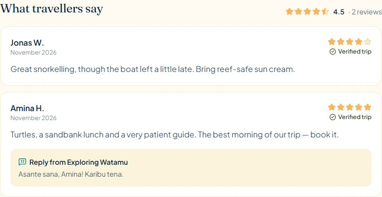
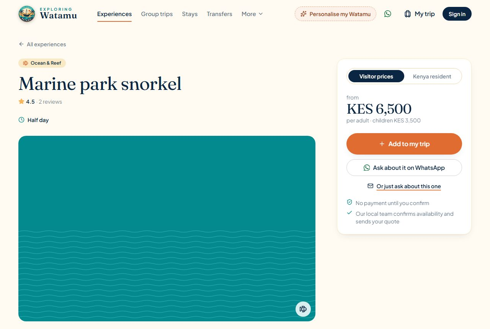
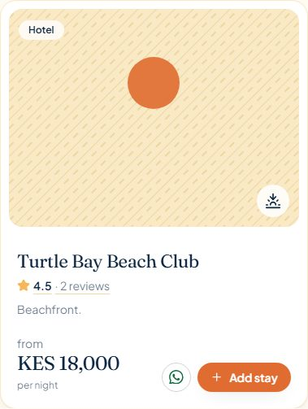
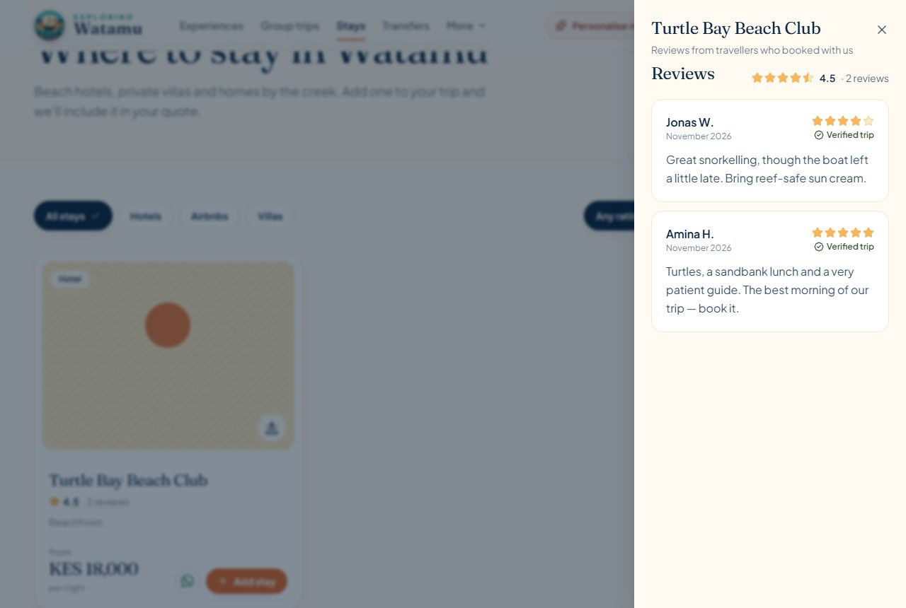
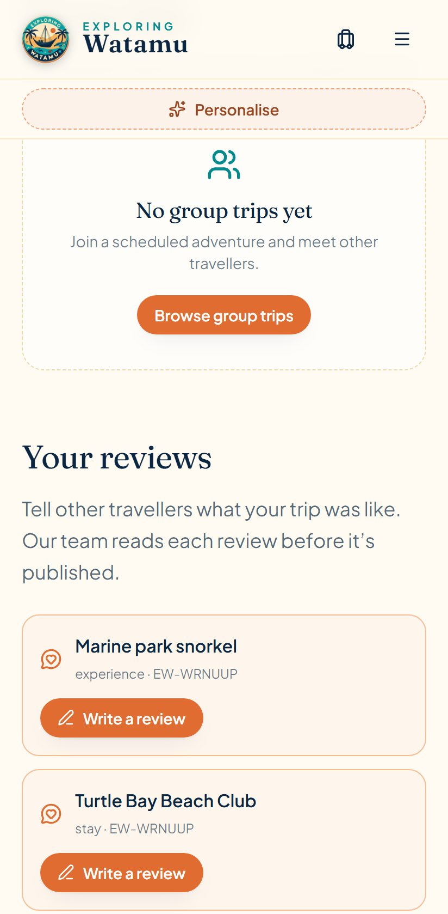
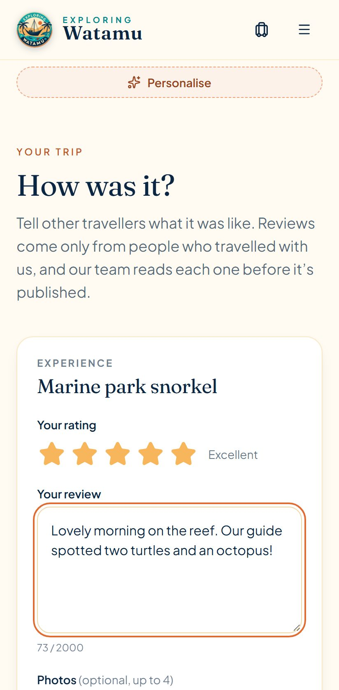
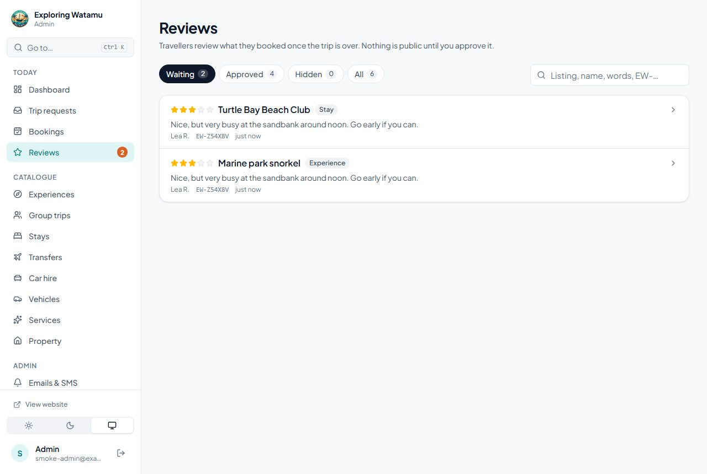
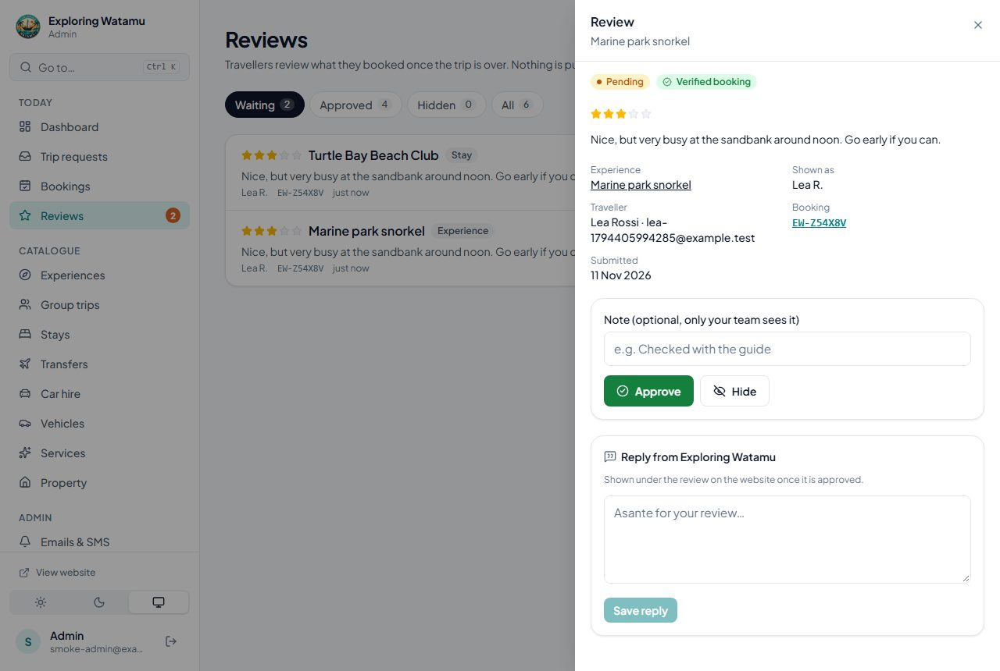
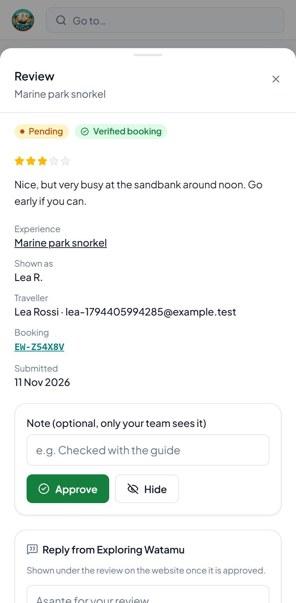

# Verified reviews

Travellers review what they booked, once the trip is over. Every review is checked
by the API against a real booking, waits for the team in the admin's **Reviews**
queue, and only appears on the website once it is approved. Listing ratings count
approved reviews only.

Covers all six listing types: experiences (`tour`), group trips (`group`), stays
(`stay`), transfers (`transfer`), car hire (`carhire`) and services (`service`).

## Who can review what (checked on the server)

A review needs a booking that proves the trip happened:

| Booking | Status needed | What can be reviewed | It has taken place when… |
|---|---|---|---|
| Trip request (website planner → quote) | `accepted` (the traveller said yes) | every listing in the accepted itinerary, once each | group trip: the group trip's end date · stay: the trip's departure (check-out) · anything else: the day it was planned on, else the departure |
| Group booking | `confirmed` | that group trip | the group trip's end date |

- **A calendar day is over at the following midnight (UTC).** A trip departing on 10 January can be reviewed from 11 January.
- **No usable date (a "flexible dates" trip) means no review.** We can't tell that the trip has ended.
- **Online payment is not required.** Payments are switched off.
- **The older direct bookings are not used.** These are the tour, service, car-hire and property-viewing bookings. They store only a typed name and contact, not an account, so they can't prove who went.
- **Planner items that aren't listings are skipped.** Examples: airport pick-ups and free-text items.

**Whose booking it is:**

- **The account that made the booking.** That is `TripRequest.user` or `GroupBooking.user`.
- **For a trip request sent as a guest (no account), either of these:**
  - an account that **owns** the same email: it confirmed it with the link emailed at sign-up, reset its password by email, or is a **Google** account (Google verified it) — `ownsEmail()` in `services/emailVerification.js`;
  - **whoever opens the review invitation emailed to that address**, signed in with any account. The link carries a signed token (audience `review-invite`, valid 120 days) that proves they can read that inbox.
- **A password account that hasn't confirmed the same email is not enough.** Sign-up alone doesn't prove the address; see [SECURITY-REVIEW.md S6](SECURITY-REVIEW.md#s6--email-confirmation-fixed).

**Duplicates.** One review per listing per booking. This is enforced by a unique index in the database, so two submissions sent at the same moment can't both get in. A traveller who books the same experience again on a later trip can review it again from that booking.

**Changing an id in the request doesn't help.** The API loads the booking itself and checks, in order:

1. the booking exists;
2. it belongs to the caller;
3. it has the right status;
4. the listing is in it, with the same type;
5. the listing still exists;
6. the date has passed.

Someone else's booking answers 404, as if it didn't exist. Hiding the button on the website is only a convenience.

## Data model (`backend/src/models/Review.js`, collection `listingreviews`)

| Field | |
|---|---|
| `listingType`, `listingId` | `tour` · `group` · `stay` · `transfer` · `carhire` · `service`, and the listing's id |
| `listingTitle` | the listing's name when reviewed (kept if renamed or removed) |
| `booking.type`, `booking.id`, `booking.reference` | `tripRequest` / `groupBooking` / `legacy`; the booking's id; `EW-…` for trip requests |
| `verified` | tied to a booking we checked (false for imported legacy reviews) |
| `user`, `displayName` | the account; shown as first name and initial ("Amina H.") |
| `rating`, `text`, `photos` | whole number 1–5; 20–2,000 characters; up to 4 Cloudinary URLs |
| `status` | `pending` (never public) · `approved` (public, counted) · `hidden` (kept, never public, not counted) |
| `moderation.by/at/note` | the last moderation action (admin email, time, optional internal note) |
| `reply.text/by/at/updatedAt` | the team's public reply (shown under an approved review) |
| `legacy.source/id` | where an imported review came from (`reviews` or `hotel.reviews`) |
| `createdAt`, `updatedAt` | timestamps |

**Indexes:**

| Query | Index |
|---|---|
| A listing's approved reviews, newest first (website, ratings) | `{ listingType, listingId, status, createdAt: -1 }` |
| A traveller's reviews | `{ user, createdAt: -1 }` |
| The moderation queue | `{ status, createdAt: -1 }` |
| A booking's reviews (eligibility, invitations) | `{ booking.type, booking.id }` |
| One review per listing per booking | **unique** `{ booking.type, booking.id, listingType, listingId }`, partial: only reviews with a booking id |
| Each legacy review imported once | **unique** `{ legacy.source, legacy.id }`, partial |

All are checked with `explain()` in `tests/e2e/indexes.e2e.test.js`.

**Public responses** (`Review.publicView`) contain only the display name, rating, text, photos, verified flag, reply and date. They never include the user, booking or moderation fields.

## Ratings

Each listing stores `reviewStats: { average, count }`, computed over its **approved** reviews (the `models/plugins/reviewStats.js` plugin):

- **Why stored on the listing:** every card and list gets the rating in the response it already loads, with no extra request per card (no N+1). JSON-LD reads it too.
- **How it stays correct:** after a review is submitted, approved, hidden, moved back to waiting, or imported, `services/reviewStats.recompute` reads that listing's approved reviews again and stores the result. It never adds or subtracts. Running it twice, or after a crash, gives the same answer, so nothing is counted twice and the numbers can't drift.
- **Protection:** listing create and update requests can't set `reviewStats`. Admin forms send whole records; the plugin drops the field from every create and update.
- **Repair:** `npm run reviews:recompute -- --confirm-db=<database name>` recomputes every listing, for example after a restore or a manual database edit.

## API

| Method and path | Who | What |
|---|---|---|
| `GET /api/reviews?listingType=&listingId=&page=&limit=` | public | approved reviews (5 per page, at most 20) and `summary: { average, count }` |
| `GET /api/reviews/eligible[?bookingType=&bookingId=&t=]` | traveller | what they can review: one booking's listings, or all their accepted or confirmed trips. Each item has `canReview`, a `reason` (`reviewed` · `not-ended` · `no-dates`), `availableFrom` and any existing `review` |
| `GET /api/reviews/mine` | traveller | their reviews with status |
| `POST /api/reviews` | traveller | `{ listingType, listingId, bookingType, bookingId, rating, text, inviteToken? }` creates a `pending` review |
| `POST /api/reviews/:id/photos` | traveller | multipart `photos` (up to 4 in total; JPG, PNG, WebP or HEIC; 8 MB each), for their own pending review only |
| `GET /api/reviews/admin?status=&listingType=&q=&page=&limit=` | admin | the queue, with `counts` per status |
| `GET /api/reviews/admin/:id` | admin | one review, with the traveller and the booking it came from |
| `PUT /api/reviews/admin/:id/status` | admin | `{ status: approved \| hidden \| pending, note? }` records who and when, and recomputes the rating |
| `PUT /api/reviews/admin/:id/reply` | admin | `{ text }` writes or edits the reply; an empty text removes it |

Zod validation through `validate`, the central error handler, and these rate limits:

- review writes and photo uploads: 30 per hour **per account**;
- public reads: the usual public limit;
- traveller reads: the session limit;
- admin: the admin limits.

**Status codes:**

- 403 with a `code` when not eligible: `NOT_ACCEPTED`, `NOT_CONFIRMED`, `NOT_ENDED`, `NO_DATES`, `NOT_IN_BOOKING`;
- 404 `BOOKING_NOT_FOUND`;
- 409 `ALREADY_REVIEWED`.

**Photos are a second step, after the review exists:**

- **Before any file is accepted,** the API checks it is the caller's own pending review.
- **A Cloudinary failure** answers 502 and leaves the review exactly as it was. The review is complete without photos, and the traveller can try again or skip.
- **Photos are moderated with the review:** they're only shown once it is approved.

The old stay-only routes are removed: `GET /api/reviews/:accommodationId`, `POST /api/reviews`, `PUT` and `DELETE /api/reviews/:id`. They let any signed-in account post, edit or delete reviews with no booking behind them, and nothing on the website used them.

## Website

- **Experience and group-trip pages:** a rating under the title, and a **What travellers say** section. It shows five reviews at a time with "Show more", with loading, error and no-reviews states.
- **Stay, transfer, car-hire and service cards:** the rating opens the reviews in a side panel, since these listings have no page of their own.
- **Experience cards:** show the rating.
- **`/review/:bookingType/:bookingId[?t=…]`:** the review page, linked from the invitation email and from My bookings. It lists the booking's listings with their state, and has a form for each: stars, text, up to 4 photos.
- **My bookings → Your reviews:** trips waiting for a review, and the traveller's reviews with their status.
- **JSON-LD:**
  - Listing pages with approved reviews add an `AggregateRating` with the real average and count.
  - schema.org's `TouristTrip` has no `aggregateRating` property, so those pages are typed `["TouristTrip", "Product"]`.
  - Pages without approved reviews get no review markup.

## Screenshots

Local builds, demo data.

| | |
|---|---|
| Experience page: reviews, reply, rating |  |
| Rating under the title |  |
| Stay card with rating |  |
| A stay's reviews (side panel) |  |
| My bookings → Your reviews (phone) |  |
| Writing a review (phone) |  |
| Admin queue |  |
| Admin review details (desktop) |  |
| Admin review details (phone) |  |

## Admin

**Reviews** (under Today, with a badge counting reviews waiting) has these tabs: Waiting, Approved, Hidden and All. Opening a review shows:

- the full text and photos;
- the listing, linked to its edit page;
- the traveller;
- the booking, linked to the trip request or group trip;
- the submission date and the last moderation action.

It has these actions:

- **Approve**, **Hide**, **Back to waiting** (with an optional internal note);
- **Reply**: save, update or remove.

## Legacy reviews: what exists and the migration

**Before this change** there were two kinds of review, both stays only:

- a `reviews` collection (`accommodationId`, `userId`, `userName`, `rating`, `text`);
- an embedded `Hotel.reviews` array (`user` as a plain string, `rating`, `text`, `date`).

Neither was moderated or verified, and the website showed neither. **Production on 11 November 2026** (read-only, through the public API) had 1 stay and **0 reviews** in both places. The public API can't see reviews of hidden or deleted stays, so the migration also handles those.

**Strategy:**

- **The originals stay untouched.** The `reviews` collection is now read through `models/LegacyReview.js`. `Hotel.reviews` stays in the schema. Nothing writes to either.
- **The new reviews live in a new collection,** `listingreviews`.
- **`npm run reviews:migrate` copies each usable legacy review** (`services/legacyReviewMigration.js`):
  - **What a copy is:** a `stay` review of the same stay, with the same author name and date, `verified: false`, and `booking.type: 'legacy'`.
  - **Status:** it arrives as `pending`, because the old reviews were never moderated or shown; the team decides in the queue. A review of a stay that no longer exists arrives `hidden`.
  - **Not copied:** reviews with a rating outside 1–5, empty text, or no stay. They're reported and left in place.
  - **Copied once:** each copy records `legacy.source` and `legacy.id`, with a unique index, so running it again copies nothing twice.
- **Ratings** for the stays it touched are recomputed afterwards. Only approved reviews count, so nothing changes until the team approves.

**Running it** (on staging first, then production):

```bash
cd backend
MONGODB_URI=<the database> npm run reviews:migrate -- --dry-run                 # what would be copied, and why not
MONGODB_URI=<the database> npm run reviews:migrate -- --confirm-db=<db name>    # copy
```

It refuses to write unless `--confirm-db` names the database it is connected to. It never changes or deletes anything, so it is safe to run on production and to repeat.

## Post-trip review invitations

The job lives in `scripts/sendReviewInvites.js` and `services/reviewInvites.js`.

**What it sends.** One email per finished booking ("How was your Watamu trip?"):

- it lists the listings that can still be reviewed;
- it links to `/review/<type>/<id>?t=<invitation>`.

**When.** For bookings whose trip ended between 1 and 60 days ago:

- accepted trip requests, by their departure date (or their arrival date if that's all they have);
- confirmed group bookings, by the group trip's end date.

**Skipped:**

- bookings with nothing left to review, or no reviewable listings;
- bookings already invited.

**Safety:**

- **One invitation per booking, ever.** Each booking has one `ReviewInvite` record, with a unique key. The run that creates it is the one that sends, even if two runs overlap.
- **Bookings and trip requests are only read,** never written.
- **A failed email** is recorded on the invitation and retried by the next run, up to 3 attempts. Every attempt is also logged in **Emails & SMS** (the Notification log), as `review_invite`.
- **With SMTP unset,** it sends nothing and records nothing, so the invitations go out once email is configured, if the trip is still within the 60 days.
- **By default it is a dry run.** It only sends with `--send`, and refuses `--send` unless `NODE_ENV=production`.

**Language.** The email, and the review page its link opens, are in the language the traveller booked in (`locale` on the trip request or booking; English for older records). See [LOCALISATION.md](LOCALISATION.md).

```bash
npm run reviews:invite                         # dry run: who would be invited
npm run reviews:invite -- --now=2027-01-20     # dry run as of another day
NODE_ENV=production npm run reviews:invite -- --send
```

### Scheduling it on Render

The repo has no scheduler. A timer inside the web server would be unreliable, because the free instance sleeps and restarts. Use a **Render Cron Job** (a separate service). It is billed by Render for the minutes it runs; see Render's pricing.

1. **Create the job:** Render → **New → Cron Job**, connected to this repository.
2. **Commands:**
   - Root directory: `backend`
   - Build command: `npm ci --omit=dev`
   - Command: `npm run reviews:invite -- --send`
3. **Schedule:** `0 7 * * *` (daily at 07:00 UTC = 10:00 in Kenya).
4. **Environment:** the same values as the API service:
   - `NODE_ENV=production`
   - `MONGODB_URI`
   - `JWT_SECRET` (must be the same, or the links won't open)
   - `FRONTEND_URL` (the website)
   - `SMTP_HOST`, `SMTP_PORT`, `SMTP_SECURE`, `SMTP_USER`, `SMTP_PASS`, `MAIL_FROM`

   An environment group shared with the API service avoids copying the values.
5. **Check it:** **Trigger run** once and read the job's log ("N sent, N failed; N skipped"). Then check Admin → **Emails & SMS** for `review_invite` rows.

A commented Blueprint version is at the end of `render.yaml`.

**Without a paid cron:** run the same command by hand from a machine that has the production environment, for example weekly. It is safe to repeat.

## Tests

- **API unit tests** (`tests/reviews.test.js`): validation, display names, invitation tokens (forgery, expiry, never a sign-in token), legacy mapping, the query-validation fix.
- **API end to end** (`tests/e2e/reviews.e2e.test.js`):
  - eligibility for all six types, ownership, status and dates;
  - Google accounts, confirmed and unconfirmed password accounts, and invitations for guest requests;
  - id tampering, duplicates (including two at once), validation, rate limit;
  - photos (own pending review only, limits, non-images, Cloudinary failure);
  - public visibility, moderation, replies, ratings (approve, hide, re-approve without double counting), protected `reviewStats`;
  - the old routes are gone.
- **Jobs** (`tests/e2e/reviewJobs.e2e.test.js`):
  - migration: dry run, mapping, originals untouched, idempotent, ratings, the database-name guard;
  - invitations: window, dry run, email off, one per booking, retries and giving up, overlapping runs, the link opening a guest request, production-only `--send`.
- **Also:** indexes and authorization are covered in the existing suites.
- **Website:** `src/lib/reviews.test.js` (ratings, JSON-LD) and `src/components/reviews/Reviews.test.jsx` (states, paging, the form, photo failure).
- **Admin:** `src/screens/Reviews.test.jsx` (queue, details, approve, hide, reply, errors).
