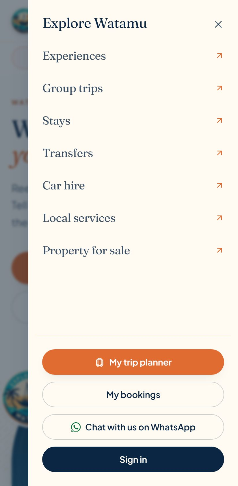
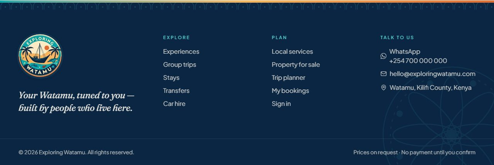
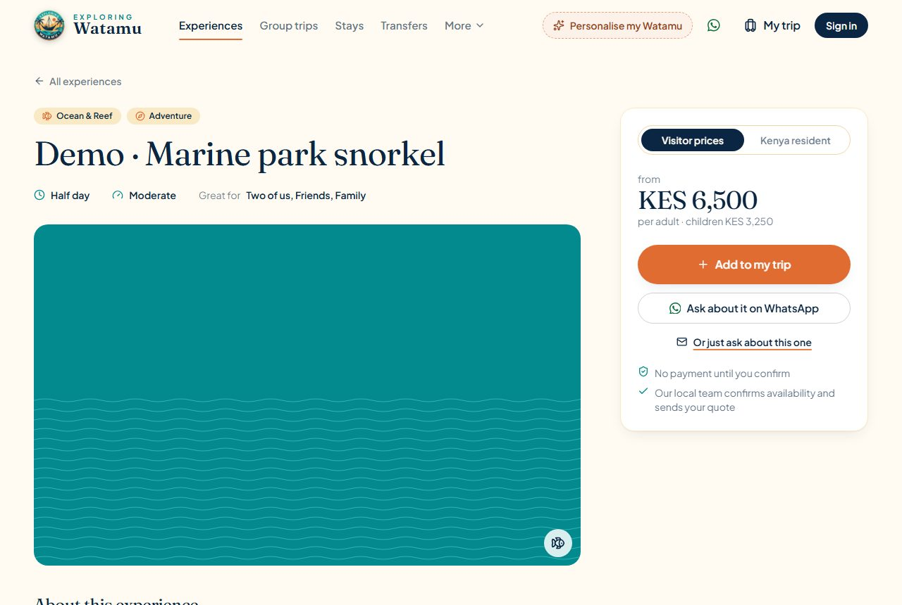
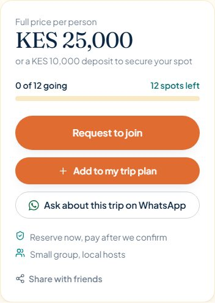
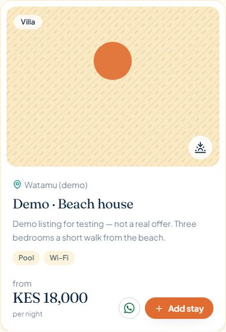
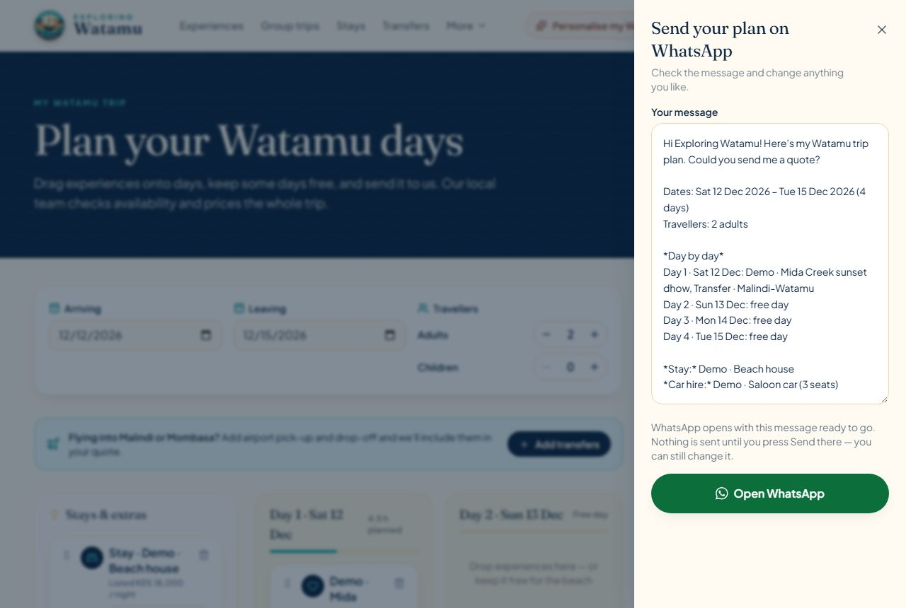
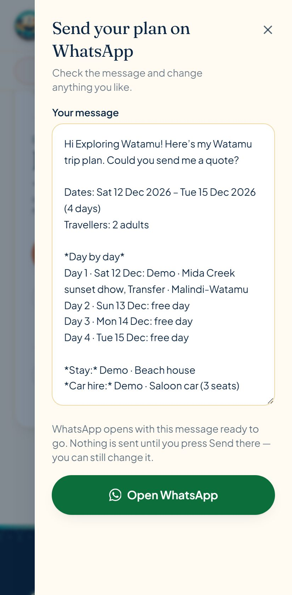
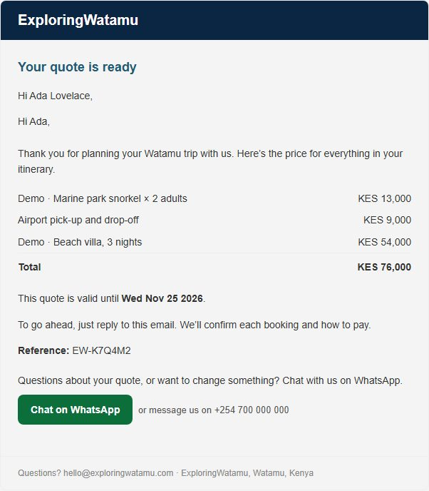
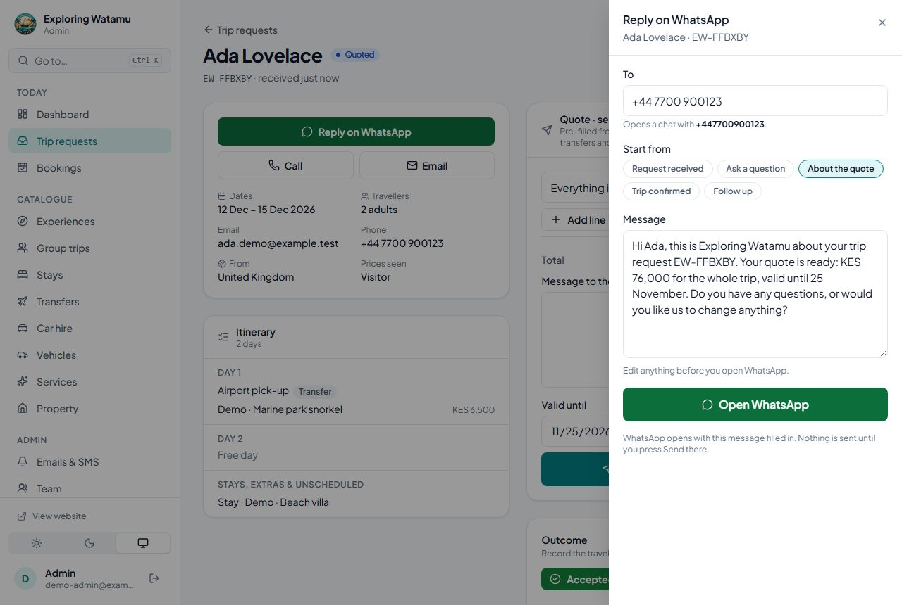
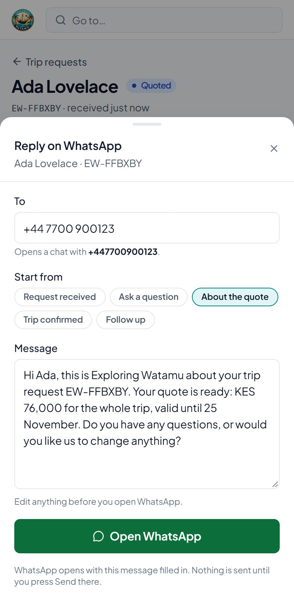

# WhatsApp click-to-chat

Travellers can reach the team on WhatsApp from the website and from their quote
emails, and the team can reply to a trip request on WhatsApp from the admin. Every
WhatsApp action is a **link** (`https://wa.me/<number>?text=<message>`): it opens
WhatsApp with a message filled in, and nothing is sent until the person presses
**Send** there. The platform never sends WhatsApp messages and holds no WhatsApp
credentials.

## Turning it on

Set the public business WhatsApp number, in international format, in **both** places:

| Where | Variable | Used for |
|---|---|---|
| Vercel → website project (`client-vite`) | `VITE_WHATSAPP_NUMBER` | The buttons on the website |
| Render → API | `WHATSAPP_NUMBER` | Links in quote emails and quotation PDFs |

e.g. `+254 712 345 678` (spaces and dashes are fine; `0712 345 678` is read as
Kenyan). Then **redeploy the website**: Vite builds `VITE_` values into the site,
so a new value only appears after a new deployment. The API picks its value up on
restart (saving the variable on Render restarts it).

*Check:* the website footer shows **WhatsApp +254 …** under "Talk to us", and
`GET /api/health/ready` shows `"whatsappLinks": true`.

**Off** (variable empty, or not a usable number): every WhatsApp button is hidden —
never a dead link — and emails leave the WhatsApp option out. A value the API can't
use is logged once at startup (`WhatsApp links off: WHATSAPP_NUMBER is not a usable
number …`); it never stops the API.

The admin needs no setting: "Reply on WhatsApp" opens a chat with the traveller in
whichever WhatsApp account is signed in on that phone or computer (use the
business account).

## Where it appears

| Place | Prefilled message |
|---|---|
| Website header (desktop), mobile menu, footer | “Hi Exploring Watamu! I’m planning a trip to Watamu and have a question.” |
| “Ask our team” boxes on empty listing pages | The topic, e.g. “…Could you help me with hiring a car in Watamu?” |
| Experience and group-trip pages (beside *Add to my trip*) | The listing’s name, key facts (length, dates, price shown) and its page link |
| Stay, transfer, car-hire and service cards (icon button) | The listing’s name and key facts (type, seats, listed rate) |
| Trip planner → **Send plan on WhatsApp** | The itinerary (below), shown in an editable box first |
| “Request sent” page, My bookings → quote | “…I have a question about my trip request / quote EW-…” |
| Quote email, trip-request acknowledgement, group-trip quotation email and PDFs | “…I have a question about my quote EW-…” (or the trip request / booking reference) |
| Admin → Trip request → **Reply on WhatsApp** | Picked from the request’s status, editable (below) |

**Trip planner message.** Reference (once sent), dates, travellers, day by day, then
the stay, transfers, car hire, services and unscheduled experiences. The visitor
reviews and can edit it before WhatsApp opens. Long plans are shortened step by step
(shorter day lines, then a summary) so the link stays under 1,800 encoded characters
— long links get cut off by some in-app browsers. Notes, names and contact details
are left out.

**Admin replies.** Starting messages: *Request received*, *Ask a question*, *About
the quote* (total and validity), *Trip confirmed*, *Follow up*. The default fits the
status; the admin edits before opening WhatsApp. They mention the reference, dates,
party size and quote — never the traveller’s notes or contact details.

## Languages

On the Italian website every prefilled message is in Italian (“Ciao Exploring Watamu! …”),
and page links in it point at the Italian page. Emails and PDFs for a traveller who used
the Italian site carry Italian messages and an Italian **Scrivici su WhatsApp** button.
In the admin, **Reply on WhatsApp** starts in the traveller’s language, with an
**English / Italiano** choice. Messages: `client-vite/src/locales/whatsapp.js`,
`backend/src/i18n/*.js`, `admin-vite/src/lib/tripReplies.js`. See
[LOCALISATION.md](LOCALISATION.md).

## Screenshots

Taken from local builds with demo listings and a placeholder number (+254 700 000 000).

| | |
|---|---|
| Header (desktop) |  |
| Mobile menu |  |
| Footer |  |
| Experience page |  |
| Group trip |  |
| Stay card |  |
| Trip planner (desktop) |  |
| Trip planner (phone) |  |
| Quote email |  |
| Admin (desktop) |  |
| Admin (phone) |  |

## Phone numbers

wa.me needs the full international number. The same rules are used in all three
apps (`backend/src/utils/whatsappNumber.js`, `client-vite/src/lib/whatsapp.js`,
`admin-vite/src/lib/whatsapp.js` — keep them in step; each has the same tests):

- International: `+254 712 345 678`, `+44 (0)20 7946 0018`, `0044 20 7946 0018`.
- Kenyan without `+`: `254712345678`, and local mobiles `0712 345 678` / `0112 345 678`.
- Anything else without a country code is refused: `0772 123 456` could be Ugandan,
  `2025550123` American, and a wrong guess sends a traveller’s trip to a stranger.
  The admin’s reply screen says when it assumed a Kenyan number and shows the
  traveller’s country next to it; a refused number can be corrected in the “To” field.
  The admin’s list screens only show their quick WhatsApp button for numbers that
  pass (before Phase 4 a number like `2025550123` produced a link to an Egyptian
  number).

## Tests

- API: `backend/tests/whatsapp.test.js` — number rules, URL encoding, config, links in
  every quotation email and PDF (escaped), none without a number or in team emails.
- Website: `src/lib/whatsapp.test.js` (numbers, messages, long-plan shortening) and
  `src/components/contact/WhatsApp.test.jsx` (hidden when off; header, menu, footer;
  the planner’s review step).
- Admin: `src/lib/whatsapp.test.js`, `src/lib/tripReplies.test.js`,
  `src/screens/WhatsAppReply.test.jsx`.
- Browser: `e2e/tests/whatsapp.spec.js` — the real builds with a placeholder number;
  links are checked, never followed.

No test opens WhatsApp or sends a message.

## Not built: automated WhatsApp messages (Business Cloud API)

Automatic WhatsApp notifications (e.g. “your quote is ready”) would need a verified
Meta Business account, a WhatsApp Business Platform number, approved message
templates and a stored access token. None of that exists today, so it was not
built. If it’s wanted later, it fits the existing notification pattern: a
`services/notifications/whatsapp.js` next to `sms.js`, behind a feature flag, a
no-op until configured, fire-and-forget, each attempt recorded in `Notification`,
tests against mocked API responses only.
